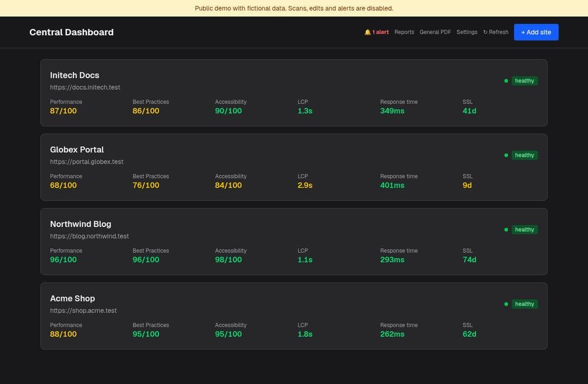
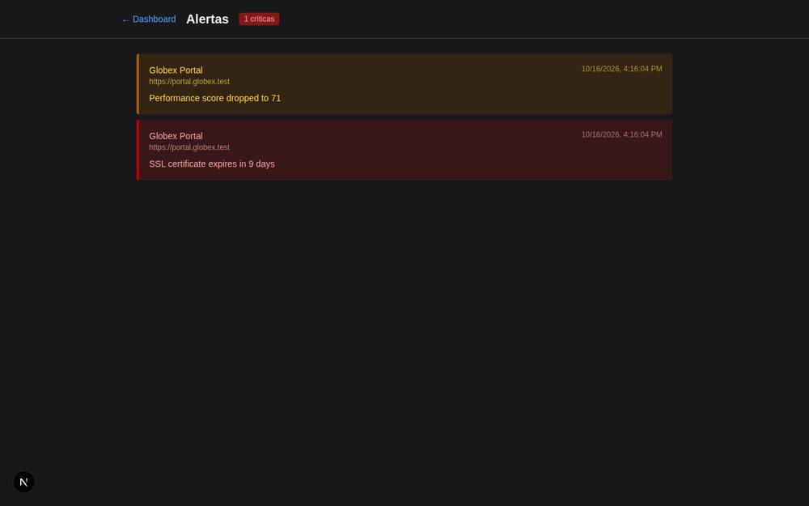
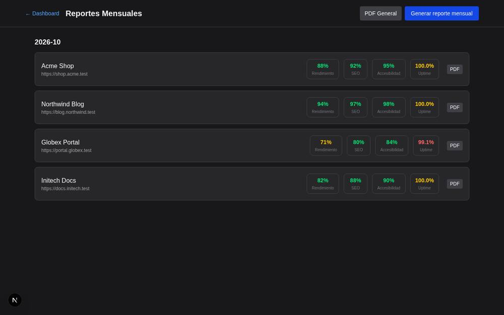
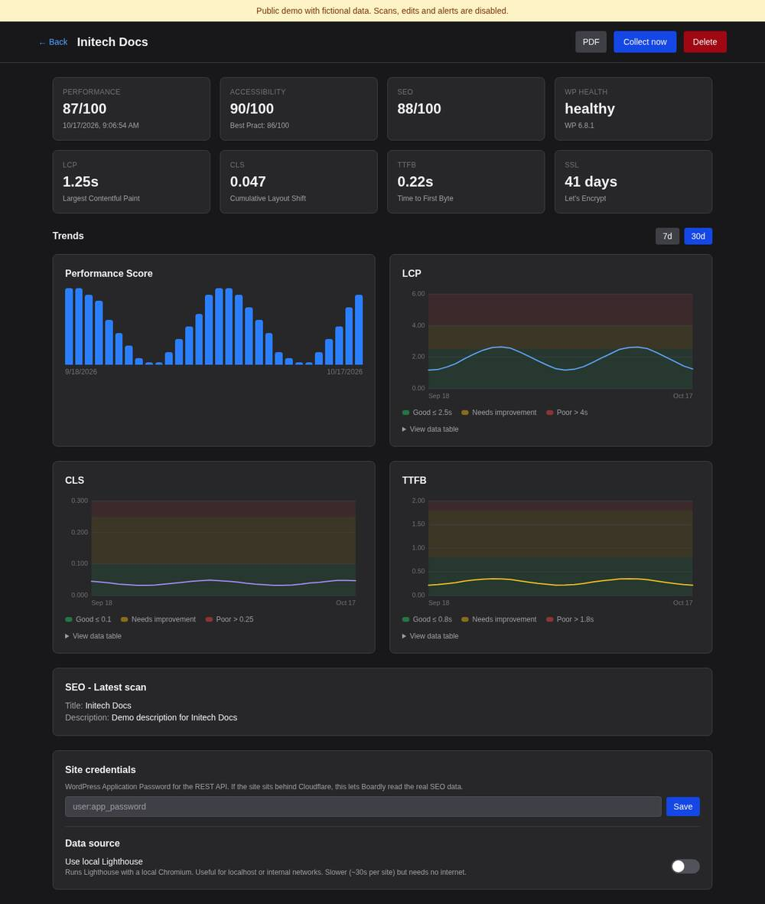

# Boardly

[](https://github.com/Lacho00/boardly/actions/workflows/ci.yml) [](LICENSE)

Monitor performance, uptime, SSL and SEO for several websites from one dashboard. Built with Next.js, React and Prisma.

**[Live demo](https://boardly-silk.vercel.app)**: read-only, with fictional data. Scans, edits and alerts are disabled.



## What it does

- **Uptime and health checks** on a schedule, with WordPress version and plugin count when the site exposes them.
- **Performance** from PageSpeed Insights (LCP, CLS, TTFB, best practices), or from a local Lighthouse run for sites behind a firewall or on a local domain.
- **SEO and accessibility audits**: title, description, H1 count, images without alt text, accessibility score.
- **SSL monitoring**: validity, issuer and days until expiry.
- **Alerts** inside the app and through a Slack webhook when a site goes down, its certificate is about to expire, or its score drops.
- **Monthly PDF reports** per site and a general report across all sites.

| Alerts | Reports |
|---|---|
|  |  |

Per-site detail, with Core Web Vitals charts and a 7 or 30 day range:



## Stack

Next.js 16 (App Router) · React 19 · TypeScript · Tailwind CSS 4 · Prisma 5 + SQLite · Lighthouse · pdfkit / pdf-lib

The UI is a set of React server and client components. Data collection lives in `src/lib/` (one module per check) and runs from the cron routes in `src/app/api/cron/`.

## What's inside

- **Server Components** for the dashboard and site pages. They read through `src/lib/queries.ts` and use `loading.tsx`, `error.tsx` and `not-found.tsx` boundaries.
- **Server Actions** (`src/app/actions.ts`) for adding, editing and deleting sites. Forms use `useActionState`, `useFormStatus` and `useOptimistic`, and every action refuses to run in demo mode.
- **Dependency-free SVG charts**: `LineChart` draws Core Web Vitals with Good / Needs improvement / Poor bands. The geometry lives in pure functions in `src/lib/chart.ts`, and the range (`?range=7|30`) is kept in the URL.
- **Types derived from Prisma** in `src/lib/types.ts`, so components never redeclare the data model.
- **Tests and CI**: Vitest and Testing Library cover the chart maths, components and actions. CI runs the tests on every PR.

## Run it locally

```bash
npm install
cp .env.example .env
npm run db:push     # create the SQLite database
npm run db:seed     # optional: four fictional sites with 30 days of metrics
npm run dev
```

Run the tests with `npm test`.

Open http://localhost:3000. `GOOGLE_PSI_API_KEY` is optional and raises the PageSpeed Insights quota.

To collect real data, add your sites in the app and call `GET /api/cron/collect` and `GET /api/cron/health` from any scheduler. Set `CRON_SECRET` to require `Authorization: Bearer <secret>` on those routes. Set the Slack webhook under Config.

Boardly has no user authentication. Do not expose a non-demo instance to the public internet without putting it behind your own auth (reverse proxy, VPN or similar).

## Project layout

```
prisma/schema.prisma   data model: Site, HealthCheck, PerformanceSnapshot, SeoAudit, SslCheck, Alert, MonthlyReport
src/app/               pages (dashboard, alerts, reports, settings) and API routes
src/lib/               collectors, notifier, PDF helpers
scripts/               local Lighthouse runner
```

## License

[MIT](LICENSE)
